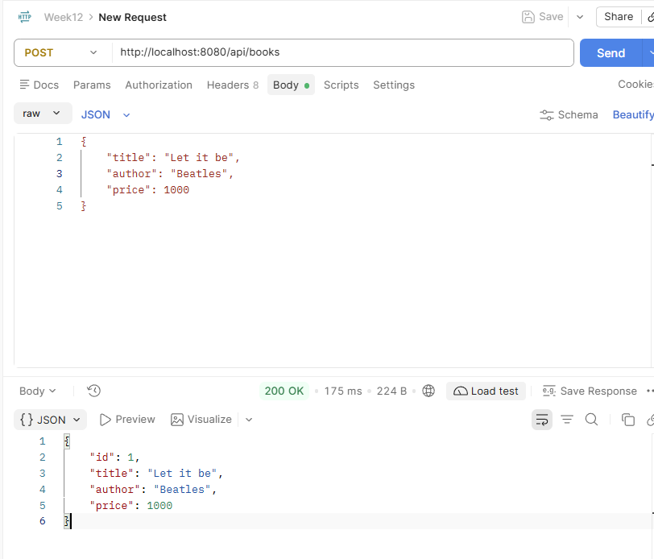
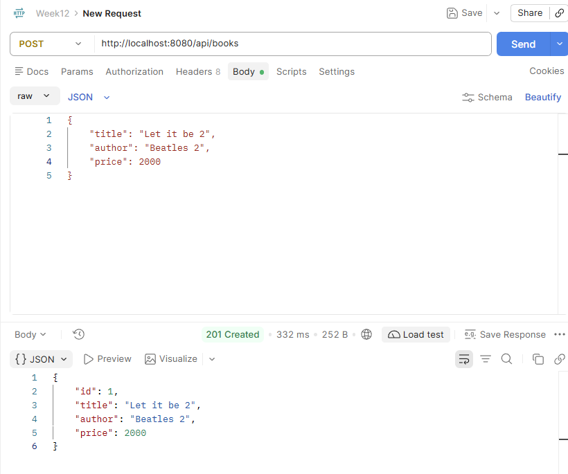
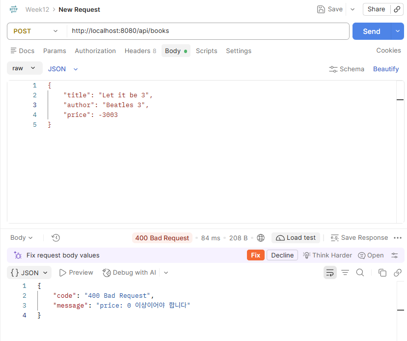
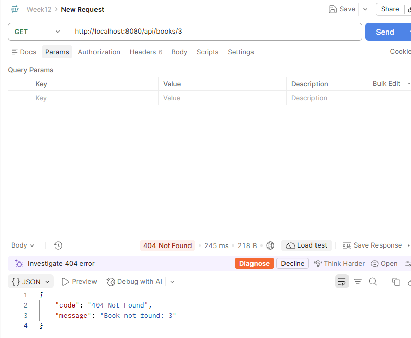
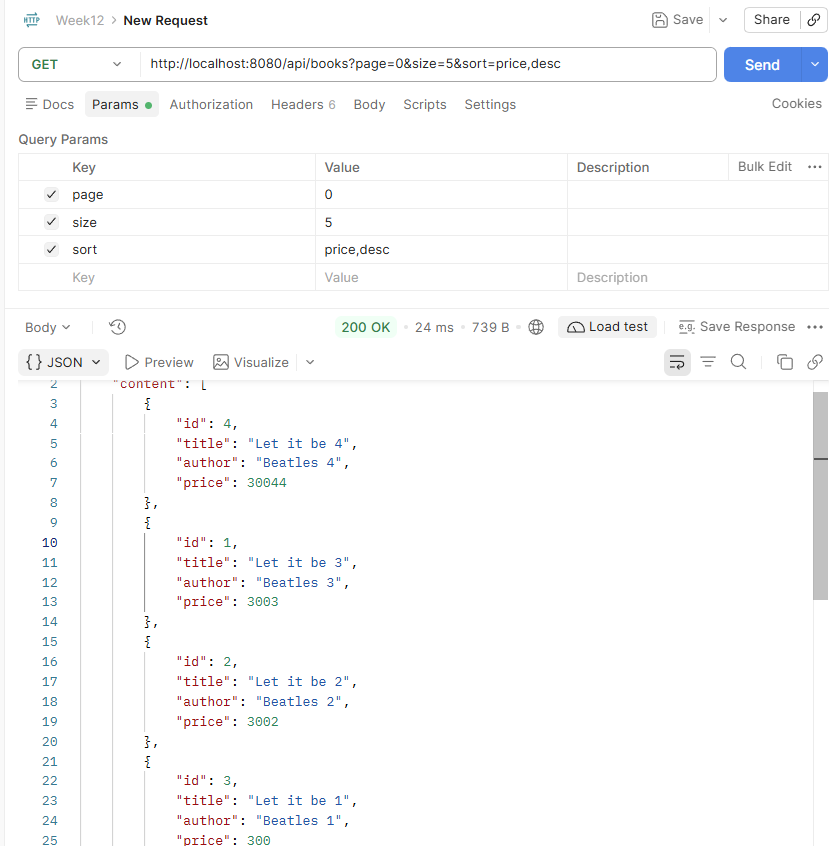
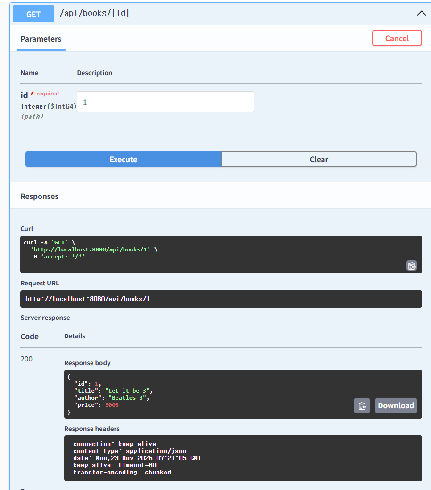

## 1. Project Information
- 프로젝트 소개: Spring Boot와 Spring Data JPA를 사용한 책 관리 REST API 프로젝트이다. 책의 제목, 저자, 가격 정보를 관리할 수 있다.
- GitHub URL
  - 배포: https://github.com/Safina-Noah/week12_assignment.git
  - 과제제출: https://github.com/2026-2-WebService/assign12-c01-22100063
- Render URL: https://week12-assignment.onrender.com

---

## 2. Installation

### 실행 환경

- Java 17 JDK
- Spring Boot 3.5.7, Spring Data JPA
- DB: MariaDB

### 기본 실행 (Windows PowerShell)

프로젝트 폴더에서 다음 명령어를 실행한다.

```powershell
.\gradlew.bat bootRun
```

기본 포트는 8080이다.

---

## 3. Source Code Exploration
### 분석 질문 8개
#### 1. Project Structure & JPA
   1. BookController, BookService, BookRepository의 역할과 요청 처리 흐름을 설명하세요.
   ```text
    Answer: BookController는 HTTP 요청을 받아 Service를 호출하고 결과를 응답한다.
    BookService는 비즈니스 로직을 수행하고 BookRepository를 호출한다.
    BookRepository는 DB 조회나 저장 등 데이터 관련 작업을 담당한다.
    목록 조회 요청은 Controller - Service - Repository - DB 순서로 처리되고,
    조회 결과는 DB - Repository - Service - Controller - 클라이언트 순서로 전달된다.
   ```

   2. JpaRepository<Book, Long>만 선언해도 findAll(), save()를 사용할 수 있는 이유를 설명하세요.
   ```text
    Answer: BookRepository가 JpaRepository<Book, Long>을 상속하면 Spring Data JPA가
    런타임에 프록시 구현체를 생성해 등록한다. 따라서 findAll(), save() 같은
    기본 CRUD 메서드를 직접 구현하지 않아도 사용할 수 있다.
    Book은 대상 엔티티 타입이고, Long은 엔티티의 ID 타입이다.
   ```

#### 2. DTO & HTTP Response
   1. 기존 API가 Book Entity를 직접 요청·응답에 사용할 때 발생할 수 있는 문제를 설명하세요.
   ```text
    Answer: 엔티티를 요청 데이터로 직접 받으면 클라이언트가 id까지 전달할 수 있다.
    id는 DB가 생성하고 관리해야 하므로, 클라이언트가 임의의 값을 지정하면
    기존 ID와 충돌하거나 데이터 관리에 문제가 생길 수 있다.
   ```
           
   2. Request DTO와 Response DTO를 분리하는 이유와 ResponseEntity가 필요한 상황을 설명하세요.
   ```text
    Answer: 
    요청과 응답 DTO를 분리하면 요청과 응답의 목적에 맞게 데이터를 구성할 수 있다.
    ResponseEntity는 응답 본문뿐 아니라 HTTP 상태 코드와 헤더를 지정할 때 사용한다.
    예를 들어 책 생성 성공 시 Response DTO와 201 Created 상태 코드를 함께 반환할 수 있다.
   ```

#### 3. Validation & Exception Handling
   1. @Valid, @NotBlank, @Min은 각각 어느 시점에 어떤 동작을 수행하나요?
   ```text
    Answer: @Valid를 요청 DTO에 적용하면 요청 JSON이 DTO로 변환된 뒤,
    Controller 메서드가 실행되기 전에 DTO에 선언된 검증 규칙을 실행하도록 한다.
    @NotBlank는 문자열이 null이거나 비어 있거나 공백만 있는 경우를 허용하지 않는다.
    @Min은 숫자가 지정한 최솟값 이상인지 검사한다.
   ```

   2. @RestControllerAdvice와 @ExceptionHandler를 사용하면 예외 처리 흐름이 어떻게 바뀌나요?
   ```text
    Answer: @RestControllerAdvice는 여러 Controller의 예외를 공통으로 처리할 클래스를 지정하고,
    @ExceptionHandler는 특정 예외가 발생했을 때 실행할 처리 메서드를 지정한다.
    따라서 Controller마다 예외 처리 코드를 반복하지 않고 오류 응답을 일관되게 관리할 수 있다.
   ```


#### 4. Pagination & OpenAPI
   1. Pageable과 Page<T>는 각각 어떤 역할을 하며 sort=price,desc는 어떻게 처리되나요?
   ```text
    Answer: Pageable은 페이지 번호, 페이지 크기, 정렬 조건을 전달하는 객체이다.
    Page<T>는 해당 페이지의 데이터와 전체 항목 수, 전체 페이지 수 등의 정보를 담는 결과 객체이다.
    전체 데이터를 가져와 Java에서 나누는 것이 아니라, Repository가 Pageable 조건을 이용해
    DB 조회 범위를 제한한다. Page<T>에는 요청한 한 페이지의 데이터만 담긴다.
    sort=price,desc는 Pageable의 정렬 조건으로 해석되어 가격 기준 내림차순 조회에 적용된다.
   ```

   2. /v3/api-docs와 /swagger-ui.html의 역할을 구분해서 설명하세요.
   ```text
    Answer: /v3/api-docs는 API 경로와 요청, 응답 구조 등을 JSON 형태로 제공한다.
    /swagger-ui.html은 이 명세를 사람이 보기 쉬운 웹 화면으로 보여주며,
    API 요청을 직접 보내 보고 응답을 확인할 수 있게 한다.
   ```
---

## 4. Refactoring
- DTO와 ResponseEntity 변경 전/후

### 변경 전

책 등록 요청에 대해 200 OK와 책 데이터를 반환한다.



### 변경 후

Request DTO로 입력을 받고 Response DTO로 생성 결과를 반환하며, ResponseEntity로 201 Created 상태 코드를 지정한다.



---

## 5. New Features
- Validation, 공통 예외 처리, Pagination/Sorting, Swagger

### Validation

음수 가격을 입력하면 검증에 실패하여 400 Bad Request와 code, message 필드가 있는 JSON 오류 응답을 반환한다.



### 공통 예외 처리

존재하지 않는 책을 조회하면 404 Not Found와 공통 형식의 JSON 오류 응답을 반환한다.



### Pagination / Sorting

GET /api/books?page=0&size=5&sort=price,desc 요청으로 첫 페이지를 최대 5권씩 가격 내림차순으로 조회한다.



### Swagger

Swagger UI에서 책 단건 조회 API에 ID를 입력해 실행하고, 200 OK와 응답 본문을 확인한다.



---

## 6. Testing & Deployment

01_sample.png


02_dto_created.png


03_validation.png


04_not_found.png


05_pagination.png


06_swagger.png


- 배포 URL: [Render 서비스](https://week12-assignment.onrender.com)
- 배포 Swagger UI: [API 문서 화면](https://week12-assignment.onrender.com/swagger-ui.html)
- 배포 OpenAPI JSON: [API 명세](https://week12-assignment.onrender.com/v3/api-docs)

---
## 7. Weekly Review
- 새롭게 배운 내용 3가지
   ```text
     1. Pagination: 단순 UI 측 페이지 구현이 아니라 실제 DB에서 데이터를 paging 단위로 요청할 수 있음을 배웠다.
     2. RestControllerAdvice: 통일된 예외 처리를 할 수 있는 구조를 배웠다.
     3. api-docs / Swagger-ui: API 요청 관련 구조를 확인하고 확인할 수 있게 하는 방식을 새롭게 배웠다.
   ```

- 어려웠던 점과 해결 방법
   ```text
     RestControllerAdvice 구조 이해 및 구현이 어려웠다.
     AI 활용하여 구조 이해한 후 프로젝트에 반영하였다.
   ```

- AI 활용 내용 및 느낀 점
   ```text
    코드 구현에 활용하였고, 구현 도중 이해되지 않는 구조에 대해 질문하며 tutoring에 활용하였다.
    과제 수행 과정에서 의도적인 병목을 만드는 습관의 중요성을 학습하였다. 
   ```
